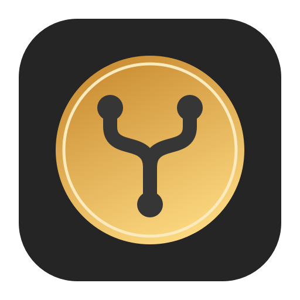
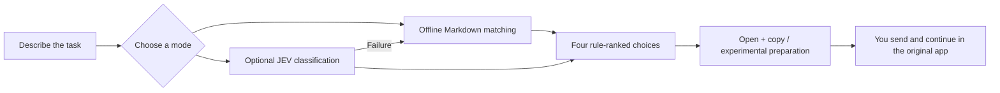

# AI Model Picker · AI 选模助手

**Pick a model for the task. Keep working in the desktop apps you already use.**

[简体中文](README.zh-CN.md) · [User guide](docs/USER_GUIDE.md) · [Features](docs/FEATURES.md) · [Downloads](https://github.com/Gavinluo19/ai-model-picker/releases) · [Known limitations](docs/RELEASE_STATUS.md)

A small native macOS assistant for people who use more than one AI service. Describe a new task, review four rule-ranked choices, choose an app/model/reasoning effort, and open or prepare the task in the original client. You send the message and continue there.

**V0.4 is an open-source alpha, not a fully validated desktop automation product.** Offline routing and public-data contracts have local tests; live JEV classification and four-client end-to-end preparation are still awaiting account-specific acceptance. The binary is ad hoc signed and **not Apple-notarized**. Start with offline recommendations and manual Open + Copy; see [release status](docs/RELEASE_STATUS.md).

## Who it helps

- Consultants, researchers, writers and developers who already use several AI tools and repeatedly hesitate over model or effort choices.
- People who want to keep their conversations and subscription use in the original apps.
- Teams and trainers who want a readable, shareable policy for common tasks rather than another generic leaderboard.

If one assistant already meets your needs, a picker may add an unnecessary step. If you need unattended API traffic routing or quota-aware CLI orchestration, see the [related projects](docs/RELATED_PROJECTS.md).

## What makes it different

| Capability | What you get |
|---|---|
| Keep the original clients | Prototype adapters for ChatGPT, Claude, TRAE CN and WorkBuddy; no replacement chat history or target-model API execution. |
| Transparent task rules | Markdown policies cover 13 task categories, priorities, fallback choices and effort branches. Rankings are policy recommendations, not measured quality scores. |
| Offline first | Deterministic bilingual keyword matching works without JEV. Ambiguous tasks ask for their main category. |
| Optional AI classification | JEV classifies the task; your local rules determine the recommendations. Network errors visibly fall back to offline matching. |
| Four choices on one page | Two international and two China-model choices from the bundled policy, with direct selection and effort/context controls. |
| Price context | API input/output references per million tokens, CNY/USD equivalents, source/date fields and descending price tables. These are not subscription charges. |
| Updateable public metadata | Public model/price catalog and daily FX refresh, cached locally with partial-failure handling and Undo. New models are discovered, not automatically promoted into routing. |
| Lightweight Mac interaction | Swift/AppKit, Dock and menu-bar entry, custom hotkey, rich-text input, word wrapping, English/Chinese and light/dark modes. V0.4 window behavior still needs live acceptance. |



## Start in five minutes

1. **Install or build.** The alpha DMG is on [Releases](https://github.com/Gavinluo19/ai-model-picker/releases). macOS may block its unnotarized binary; do not disable security protections. Building locally is the recommended route for developers/testers.
2. **Keep your existing apps installed and logged in.** The picker does not log you in, extend your quota, or grant model access.
3. **Open AI选模助手.app.** Use the Dock/menu-bar entry or the default **Control + Option + Space** shortcut. Quit older versions before starting this one.
4. **Select Offline rules.** Try: `Define the software architecture and module boundaries for a small inventory app.` Click **Recommend**.
5. **Review a card, then Open and Copy.** Set the suggested model/effort in the target app, paste your task and send it yourself. This path needs no Accessibility permission.

Optional: configure your personal JEV key in Settings for AI classification. Keys stay in macOS Keychain; AI mode sends the current task and classification conditions to JEV and may incur its API charges. The execution providers still use your original clients. Automatic **Prepare** is experimental, requires Accessibility access and stops when it cannot verify the mode, model, effort, empty composer or complete text.

Read the [detailed guide](docs/USER_GUIDE.md) for settings, examples, rule updates, price updates, permissions and recovery.

## Supported clients and availability

| Client | Intended integration | Status in this release |
|---|---|---|
| ChatGPT | Work / Codex selection and preparation | Adapter implemented; latest installed version/account must be tested. |
| Claude | Chat / Cowork / Code; account/access reminder | Adapter implemented; end-to-end acceptance pending. Extra-credit options are not enabled implicitly. |
| TRAE CN | Work / Code with bundled China-model choices | Adapter implemented; menu visibility differs by app version and account. |
| WorkBuddy | Office / Code; preserve client effort configuration | Adapter implemented; product Max is not turned on automatically. |

No universal account compatibility is claimed. Model names in `Resources/DefaultRules.md` and metadata snapshots are dated references, not proof of current subscription access. Verify your menus and uncheck unavailable models in Settings. Public catalog updates do not silently rewrite your routing policy.

## Build from source

Requirements: **macOS 14+**, Apple command-line developer tools, and system Python 3 for packaging. The app itself needs no Node/Python runtime or local server. Target clients have their own requirements.

```sh
git clone https://github.com/Gavinluo19/ai-model-picker.git
cd ai-model-picker
bash scripts/test.sh
bash scripts/build.sh
bash scripts/package.sh
```

The app is produced at `dist/AI选模助手.app`; the DMG contains a Universal2 arm64/x86_64 binary. Intel and minimum-OS runtime acceptance are pending. Current local core checks are recorded in [release status](docs/RELEASE_STATUS.md), not a claim that live accounts or desktop handoffs work.

For public binary distribution, configure a Developer ID identity and a notary profile; [developer guide](docs/DEVELOPING.md) explains the optional signing path. This alpha has neither. No GitHub Actions status is claimed: an [opt-in macOS workflow template](examples/github-actions/macos.yml) is provided separately.

## Cost, data and privacy

The software is free under MIT. Your subscriptions, optional JEV API use and any client-side extra usage remain your responsibility. Offline recommendation is local; explicitly clicking public-data updates connects to Models.dev and Frankfurter without task text or keys. Classification/preparation use the task's text, not pasted images or rich formatting. No task telemetry is uploaded.

See [PRIVACY.md](PRIVACY.md) and [SECURITY.md](SECURITY.md). API reference prices are approximate model-rate context, **not your subscription bill, remaining allowance, or predicted cost per successful task**. CNY/USD equivalents are conversions, not verified regional offers.

## Contribute

The most useful contributions are anonymized task cases, clearer routing rules, verified client adapters, localization and another-Mac acceptance results. Read [CONTRIBUTING.md](CONTRIBUTING.md), [ROADMAP.md](docs/ROADMAP.md) and the [comparison with related projects](docs/RELATED_PROJECTS.md). Do not upload keys, conversations, customer files or account screenshots.

This project is independent and not affiliated with the supported vendors. MIT: [LICENSE](LICENSE). Public-data notices: [THIRD_PARTY.md](THIRD_PARTY.md).
